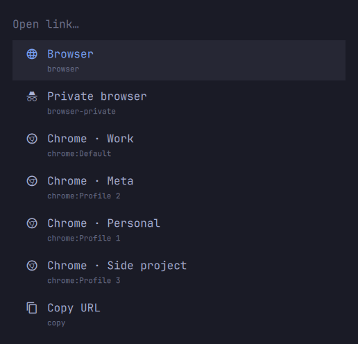
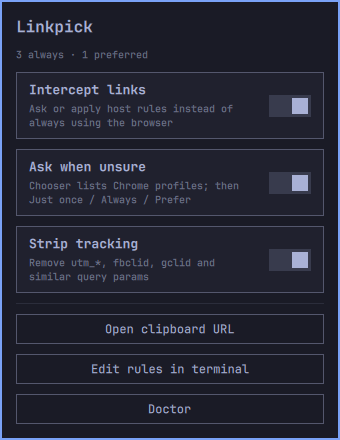

# Linkpick

Linkpick is a link chooser for [Omarchy](https://omarchy.org) (Hyprland).

When something opens an `http(s)` URL, you get a chooser — or a remembered
host rule — instead of always landing in the default browser.

Linkpick is an independent Omarchy tool inspired by LinkSheet for Android
(https://github.com/LinkSheet/LinkSheet). It is not affiliated with it.

Plugin ID: `io.github.phiberr.linkpick`

## Screenshots

The chooser:



The settings panel:



## Install

Omarchy clones this repository into your plugin directory and enables the
bar widget. It does **not** run any install hook, so you still need the
second step below to hook Linkpick into `xdg-open`, mime defaults, and
Chromium/Chrome app windows.

```bash
omarchy plugin add https://github.com/phiberr/omarchy-linkpick.git --enable
```

`omarchy plugin add` warns that plugins run unsandboxed inside the long-lived
Omarchy shell, then clones this repo into
`~/.config/omarchy/plugins/io.github.phiberr.linkpick/`.

### Wire up link handling

The following command changes your user-level link handling. Review it and
run it only if you want Linkpick to intercept `http(s)` opens. It does not
use `sudo`, but it will:

- Install wrappers at `~/.local/bin/xdg-open` and
  `~/.local/bin/omarchy-cmd-default-browser` (shadowing the system
  `xdg-open` and Omarchy's default-browser helper)
- Install `~/.local/bin/omarchy-linkpick` and the native messaging host
- Install a user desktop entry and point `hyprland-mimeapps.list` at
  `omarchy-linkpick.desktop` for `http` and `https`
- Prepend `~/.local/bin` to `PATH` via
  `~/.config/environment.d/99-omarchy-linkpick.conf` (takes effect after
  a logout/login)
- Copy the unpacked Chromium extension into
  `~/.local/share/omarchy-linkpick/extension` and append it to
  `--load-extension` in `chromium-flags.conf` and `chrome-flags.conf`
- Write native-messaging host manifests under your Chromium, Chrome, Brave,
  and Edge config directories
- If `~/.config/omarchy-linkpick/config.json` does not exist and a previous
  LinkSheet config is at `~/.config/omarchy-linksheet/config.json`, copy it
  (and any history under `~/.local/state/omarchy-linksheet/`) into the new
  paths. The originals are never deleted
- Otherwise leave an existing Linkpick config alone, or install the default
  handlers if neither config exists

```bash
~/.config/omarchy/plugins/io.github.phiberr.linkpick/bin/omarchy-linkpick install
omarchy bar move io.github.phiberr.linkpick --section right
```

Restart Chromium/Chrome (and any `--app` / PWA windows such as X or YouTube)
so the extension loads. Log out and back in once so `environment.d` puts
`~/.local/bin` ahead of `/usr/bin` and the `xdg-open` wrapper takes effect.

Until then:

```bash
~/.local/bin/xdg-open 'https://example.com'
# or
omarchy-linkpick open 'https://youtube.com/watch?v=dQw4w9WgXcQ'
```

If you are developing from a checkout that is not already the plugin
directory, you can run `bin/omarchy-linkpick install` from that checkout.
It copies only `manifest.json`, `BarWidget.qml`, and `Panel.qml` into the
plugin directory and will not delete an existing git checkout.

## Dependencies

These are part of a normal Omarchy install; Linkpick does not install or
remove system packages.

- Omarchy (Hyprland / Quickshell), including `omarchy-menu-select`,
  `omarchy-launch-browser`, and `omarchy-launch-webapp`
- Bash, Python 3 (stdlib only), and `jq`
- `xdg-open`, `xdg-settings`, and `xdg-mime`
- Optional: Chromium or Google Chrome, for profile handlers and app-window
  interception

## Commands

```bash
omarchy-linkpick open <url>
omarchy-linkpick clipboard
omarchy-linkpick enable | disable
omarchy-linkpick set-ask on|off
omarchy-linkpick set-strip on|off
omarchy-linkpick always <host> <handler|ask|clear>
omarchy-linkpick preferred <host> <handler|ask|clear>
omarchy-linkpick handlers          # includes Chrome profiles
omarchy-linkpick status
omarchy-linkpick doctor
omarchy-linkpick install
omarchy-linkpick uninstall
```

User config (not in this repository): `~/.config/omarchy-linkpick/config.json`

## Chooser

1. Pick where to open (webapps, Browser, each Chrome profile, Copy URL).
2. Pick persistence:
   - **Just once**
   - **Always open in … for host**
   - **Prefer … for host**

Chrome profiles are discovered from `~/.config/google-chrome/Local State`
(ids like `chrome:Default`, `chrome:Profile 1`).

The bar icon uses the normal foreground color and only highlights while
the settings panel is open. The tooltip still shows whether Linkpick is
on or off.

## How it works

1. `~/.local/bin/xdg-open` wraps `/usr/bin/xdg-open` and hands `http(s)` to
   the helper.
2. `hyprland-mimeapps.list` also points `http(s)` at
   `omarchy-linkpick.desktop` for portal callers.
3. `~/.local/bin/omarchy-cmd-default-browser` skips Linkpick (and
   `omarchy-browser`) so webapps still launch in Chrome/Brave/etc.
4. A Chromium/Chrome extension (loaded via `chromium-flags.conf` /
   `chrome-flags.conf`) intercepts cross-host link clicks inside `--app` /
   PWA windows and sends them to Linkpick through a native messaging host.
5. The helper expands common short URLs, strips tracking params, checks
   `always` / `preferred` host maps, then either opens a handler or shows
   `omarchy-menu-select`.
6. Handlers call `omarchy-launch-browser` / `omarchy-launch-webapp` /
   `google-chrome-stable --profile-directory=…` directly (no recursion).

## Uninstall

This removes the wrappers, helper, desktop entry, extension, native host,
PATH drop-in, and the plugin directory. It restores `http` / `https` in
`hyprland-mimeapps.list` to `omarchy-browser.desktop`. It leaves your
`~/.config/omarchy-linkpick/config.json` and click history in place, and
does not delete a previous LinkSheet config or history if those still
exist under the old paths.

```bash
omarchy-linkpick uninstall
```

If the helper is already gone, run uninstall from the plugin checkout
before it is deleted:

```bash
~/.config/omarchy/plugins/io.github.phiberr.linkpick/bin/omarchy-linkpick uninstall
```

Restart Chromium/Chrome so the extension unloads. Log out and back in if
you want the PATH change fully reversed.

## License

[MIT](LICENSE) © 2026 phiberr
